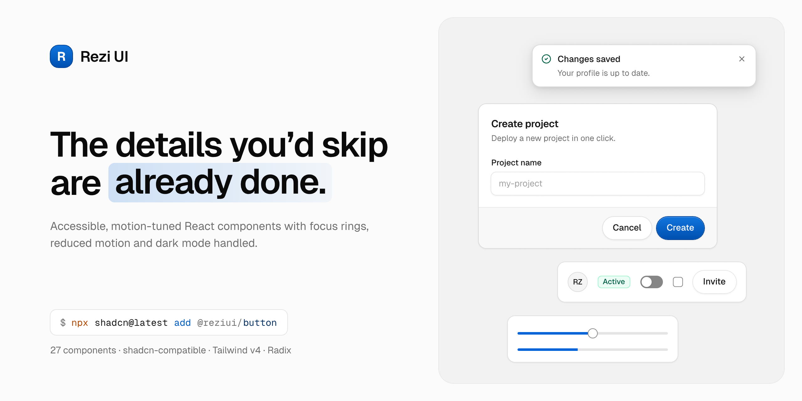
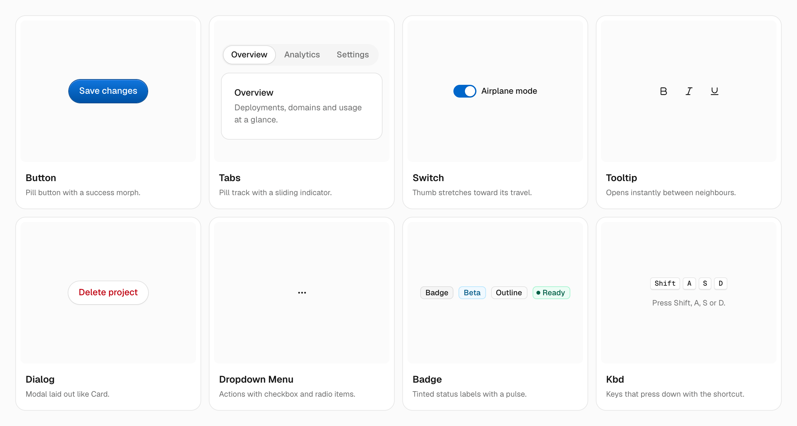

<!-- Banner and grid images live in .github/assets. The banner is the canvas
     frame "Rezi UI / README banner" (Light/Dark) in component-v1-2026.pen and
     states the component count, so re-export it when that number changes. -->
<picture>
  <source media="(prefers-color-scheme: dark)" srcset=".github/assets/banner-dark.png">
  
</picture>

<p align="center">
  <a href="https://reziui.rezianislami.workers.dev/docs">Docs</a>
  ·
  <a href="https://reziui.rezianislami.workers.dev/docs/components/button">Components</a>
  ·
  <a href="https://reziui.rezianislami.workers.dev/docs/installation">Installation</a>
</p>

<p align="center">
  <a href="LICENSE"></a>
  
  
  
  
</p>

# Rezi UI

Rezi UI is a component registry for the [shadcn CLI](https://ui.shadcn.com/docs/cli). You don't install a package: the CLI copies each component's source into your project, so you own the code and can change anything.

Every component ships with the details that usually get skipped:

| | |
| --- | --- |
| **Keyboard & focus** | Arrow keys, Escape, and a visible ring on every control you reach. |
| **Reduced motion** | Animations step aside when the system asks for less motion. |
| **Dark mode** | Every token has a dark value, with contrast checked in both. |
| **Right-to-left** | Logical spacing, with icons and slides that mirror. |

## Quick start

Rezi UI targets **Tailwind CSS v4** and **Radix**. Tailwind v3 projects are not supported.

```bash
# 1. Set up shadcn (skip if your project already has a components.json)
npx shadcn@latest init --base radix

# 2. Register the @reziui namespace
npx shadcn@latest registry add @reziui=https://reziui.rezianislami.workers.dev/r/{name}.json

# 3. Install the theme first, then any component
npx shadcn@latest add @reziui/theme
npx shadcn@latest add @reziui/button
```

Step 2 writes this to your `components.json`, so you can also add it by hand:

```json
{
  "registries": {
    "@reziui": "https://reziui.rezianislami.workers.dev/r/{name}.json"
  }
}
```

Things that are easy to miss:

- **Use `--base radix`.** Without it, `shadcn init` defaults to Base UI. Rezi UI components still install into a Base UI project, but you end up with two primitive libraries side by side.
- **Install the theme before any component.** Every component depends on `@reziui/theme`, but when the theme arrives as a dependency the CLI only adds missing variables and keeps your existing `--background`, `--primary`, `--border` and so on. Components still render, but surfaces and borders follow your old theme.
- **Point `--font-sans` at [Geist](https://vercel.com/font).** With `next/font`:

  ```tsx
  const geistSans = Geist({ variable: "--font-sans", subsets: ["latin"] });
  ```

- **Dark mode** follows the shadcn convention: add the `dark` class to an ancestor, for example `<html class="dark">`, or let [`next-themes`](https://github.com/pacocoursey/next-themes) do it.

The full guide is at [reziui.rezianislami.workers.dev/docs/installation](https://reziui.rezianislami.workers.dev/docs/installation).

## Usage

Components land in `components/ui/` and import like any other file in your project:

```tsx
import { Button } from "@/components/ui/button";

export function Example() {
  return <Button>Save changes</Button>;
}
```

They compose. This is the Card from the banner above:

```bash
npx shadcn@latest add @reziui/card @reziui/input @reziui/label @reziui/button
```

```tsx
import { Button } from "@/components/ui/button";
import { Card, CardContent, CardDescription, CardFooter, CardHeader, CardTitle } from "@/components/ui/card";
import { Input } from "@/components/ui/input";
import { Label } from "@/components/ui/label";

export function CreateProject() {
  return (
    <Card className="w-full max-w-sm">
      <CardHeader>
        <CardTitle>Create project</CardTitle>
        <CardDescription>Deploy a new project in one click.</CardDescription>
      </CardHeader>
      <CardContent>
        <div className="grid gap-1.5">
          <Label htmlFor="project-name">Project name</Label>
          <Input id="project-name" placeholder="my-project" />
        </div>
      </CardContent>
      <CardFooter>
        <Button variant="secondary">Cancel</Button>
        <Button>Create</Button>
      </CardFooter>
    </Card>
  );
}
```

Each docs page has live previews and every variant: see [Button](https://reziui.rezianislami.workers.dev/docs/components/button) for an example.

## Components

<picture>
  <source media="(prefers-color-scheme: dark)" srcset=".github/assets/components-dark.png">
  
</picture>

27 components. Install any of them with `npx shadcn@latest add @reziui/<name>`.

**Actions & menus**

| Component | Install | Description |
| --- | --- | --- |
| [Button](https://reziui.rezianislami.workers.dev/docs/components/button) | `@reziui/button` | Pill-shaped button with gradient emphasis variants, a loading state and asChild support. |
| [Dropdown Menu](https://reziui.rezianislami.workers.dev/docs/components/dropdown-menu) | `@reziui/dropdown-menu` | Menu of actions and options with checkbox and radio items, built on Radix Dropdown Menu. |
| [Command](https://reziui.rezianislami.workers.dev/docs/components/command) | `@reziui/command` | Searchable command list, inline or as a ⌘K dialog, built on cmdk. |
| [Theme Toggle](https://reziui.rezianislami.workers.dev/docs/components/theme-toggle) | `@reziui/theme-toggle` | Ghost icon button that flips light and dark through next-themes, labelled by a tooltip. |

**Forms**

| Component | Install | Description |
| --- | --- | --- |
| [Input](https://reziui.rezianislami.workers.dev/docs/components/input) | `@reziui/input` | 36px rounded-rect text field with an optional start icon and opt-in clear button. |
| [Label](https://reziui.rezianislami.workers.dev/docs/components/input) | `@reziui/label` | Field label, documented on the Input page. |
| [Textarea](https://reziui.rezianislami.workers.dev/docs/components/textarea) | `@reziui/textarea` | Multi-line field styled like Input that grows with its content. |
| [Checkbox](https://reziui.rezianislami.workers.dev/docs/components/checkbox) | `@reziui/checkbox` | 16px checkbox with a drawn-in check and an indeterminate state, built on Radix Checkbox. |
| [Radio Group](https://reziui.rezianislami.workers.dev/docs/components/radio-group) | `@reziui/radio-group` | 16px radios with a scaling dot, built on Radix Radio Group. |
| [Switch](https://reziui.rezianislami.workers.dev/docs/components/switch) | `@reziui/switch` | On/off toggle that applies immediately, built on Radix Switch. |
| [Select](https://reziui.rezianislami.workers.dev/docs/components/select) | `@reziui/select` | Input-styled select with an overlay list and the check at the end, built on Radix Select. |
| [Slider](https://reziui.rezianislami.workers.dev/docs/components/slider) | `@reziui/slider` | Value or range on a 4px track with 16px thumbs, built on Radix Slider. |

**Overlays**

| Component | Install | Description |
| --- | --- | --- |
| [Dialog](https://reziui.rezianislami.workers.dev/docs/components/dialog) | `@reziui/dialog` | Modal window with header, body and footer, laid out like Card, built on Radix Dialog. |
| [Sheet](https://reziui.rezianislami.workers.dev/docs/components/sheet) | `@reziui/sheet` | Panel that slides in from the start or end edge, laid out like Dialog, built on Radix Dialog. |
| [Popover](https://reziui.rezianislami.workers.dev/docs/components/popover) | `@reziui/popover` | Floating panel for rich, interactive content anchored to a trigger, built on Radix Popover. |
| [Tooltip](https://reziui.rezianislami.workers.dev/docs/components/tooltip) | `@reziui/tooltip` | Inverted label for icon-only controls, built on Radix Tooltip. |

**Feedback**

| Component | Install | Description |
| --- | --- | --- |
| [Alert](https://reziui.rezianislami.workers.dev/docs/components/alert) | `@reziui/alert` | Inline message with neutral and status variants, an optional icon and action. |
| [Toast](https://reziui.rezianislami.workers.dev/docs/components/toast) | `@reziui/toast` | Top-centre toasts on the overlay surface, built on Sonner; errors and actions stay until closed. |
| [Progress](https://reziui.rezianislami.workers.dev/docs/components/progress) | `@reziui/progress` | 4px determinate or indeterminate progress bar, built on Radix Progress. |
| [Skeleton](https://reziui.rezianislami.workers.dev/docs/components/skeleton) | `@reziui/skeleton` | Content-shaped loading placeholder with a soft shimmer that stops under reduced motion. |

**Layout & display**

| Component | Install | Description |
| --- | --- | --- |
| [Card](https://reziui.rezianislami.workers.dev/docs/components/card) | `@reziui/card` | Surface with header, content and a tinted footer for actions. |
| [Accordion](https://reziui.rezianislami.workers.dev/docs/components/accordion) | `@reziui/accordion` | Hairline-divided disclosure list with an animated panel height, built on Radix Accordion. |
| [Tabs](https://reziui.rezianislami.workers.dev/docs/components/tabs) | `@reziui/tabs` | Pill-track tabs with a raised active tab, built on Radix Tabs. |
| [Breadcrumb](https://reziui.rezianislami.workers.dev/docs/components/breadcrumb) | `@reziui/breadcrumb` | Trail of links to the current page, with a collapsible middle. |
| [Badge](https://reziui.rezianislami.workers.dev/docs/components/badge) | `@reziui/badge` | Rounded-rect label for status and metadata, with tinted status variants, an optional dot and asChild support. |
| [Avatar](https://reziui.rezianislami.workers.dev/docs/components/avatar) | `@reziui/avatar` | Photo or initials in a circle, in three sizes, with an overlapping group, built on Radix Avatar. |
| [Kbd](https://reziui.rezianislami.workers.dev/docs/components/kbd) | `@reziui/kbd` | Keyboard key with a 2px bottom edge, plus a group for shortcuts. |

## Theming

`@reziui/theme` sets the shadcn color variables (`--background`, `--primary`, `--border`, …) for light and dark, plus a few Rezi UI tokens such as `--surface-elevated`, `--hairline` and the `--btn-*` gradients the emphasis buttons are drawn with. They live in your global CSS after install, so you retheme by editing the values. Components read their own `--btn-*` tokens, so buttons keep their look even if you keep your existing theme.

## Development

```bash
npm install
npm run dev            # docs site at http://localhost:3000
npm test               # Vitest + Testing Library
npm run lint
npm run registry:build # registry/ → public/r/*.json
```

- Components live in `registry/reziui/ui/`, their demos in `registry/reziui/examples/`. Each is listed in `registry.json` and documented in `content/docs/components/`.
- After adding or changing a component, run `npm run registry:build` and commit the regenerated `public/r/*.json`. The deployed site serves those files as-is, and a test fails when one is missing or stale.
- A new component also needs a row in the [Components](#components) table above; a test checks that every registry item is listed.

## Deployment

The site is a static export (`output: "export"` → `out/`) served by Cloudflare Workers Static Assets; see `wrangler.toml`. There is no server: the docs search index is emitted at build by `app/api/search` and searched in the browser.

```bash
npm run build && npx wrangler@4.147.0 versions upload   # preview URL, production untouched
npm run build && npx wrangler@4.147.0 deploy            # production
npx wrangler@4.147.0 rollback                           # previous version
```

With Workers Builds connected to the GitHub repo, use build command `npm run build` and deploy command `npx wrangler deploy`.

Gotchas:

- Everything is computed at build, including the "New" labels on docs pages, so they only change on the next deploy.
- The registry URL is stored in every consumer's `components.json`. Changing the domain breaks existing installs unless the old host redirects `/r/*` to the new one.

## License

[MIT](LICENSE). Some design tokens are adapted from third-party work; see [THIRD_PARTY_NOTICES.md](THIRD_PARTY_NOTICES.md).
